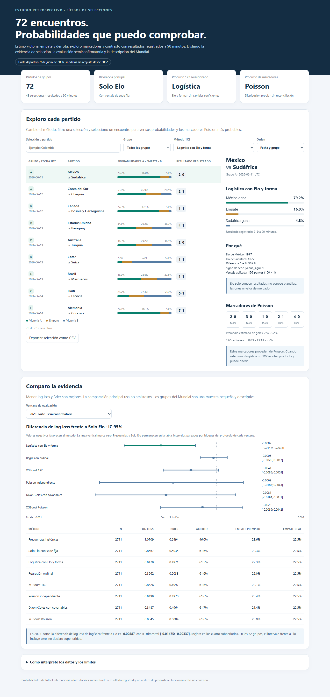

# ¿Le gana el machine learning a Elo? Evaluación retrospectiva de 8 modelos en fútbol de selecciones y el Mundial 2026

**3.624 partidos · protocolo sellado con hashes · 72 partidos del Mundial**

**Pregunta:** ¿mejoran el aprendizaje automático y los modelos de goles a un Elo simple al predecir partidos de selecciones?

**Resultado:** en no amistosos, la logística con Elo y forma reduce el log loss en **0.0089** (≈1% relativo; IC [-0.0147; -0.0034]) y el acierto es prácticamente igual (61.53% frente a 61.56%). XGBoost y los modelos de goles no demuestran una mejora robusta en esta evaluación semiconfirmatoria. La ventaja tampoco queda demostrada entre selecciones fuertes ni en los grupos del Mundial. [Fuente: métricas ejecutadas](reports/final_evaluation/semiconfirmatory_metrics.csv).


## Por qué hice este proyecto

Empecé este trabajo a partir de una entrega para una competencia de DataCamp. La meta era simple: sumar puntos prediciendo el Mundial 2026. Me interesaba aplicar XGBoost a un problema deportivo concreto y convertirlo después en un proyecto para mi portafolio. Al revisar la entrega, vi que una puntuación por sí sola no respondía lo que más me importaba: si el modelo aprendía algo útil o si la complejidad solo hacía más difícil entenderlo. Replanteé el estudio con otra pregunta: **¿le gana el machine learning a un Elo simple?**

Los datos útiles para el ajuste eran, sobre todo, resultados de partidos. No tenía una cobertura histórica suficiente de plantillas, lesiones o cuotas con fecha para compararlos en las mismas condiciones. Eso definió el propósito: medir cuánto aporta el machine learning cuando comparte con Elo una información limitada, sin presentarlo como un modelo capaz de competir con las casas de apuestas.

Fijé el protocolo y los hashes antes de la evaluación formal de 2023–2026 y sellé las predicciones antes del contraste oficial del Mundial. Esa separación tiene un límite: la entrega histórica de DataCamp ya había puntuado parte de ese periodo. Por eso lo llamo **semiconfirmatorio**, no una prueba completamente nueva. Todo el estudio se construyó con el torneo ya jugado; no afirmo haber publicado estas predicciones antes del Mundial.

### Qué es Elo

Elo es una calificación que sube o baja después de cada partido: ganarle a un rival fuerte suma más que ganarle a uno débil. Resume resultados pasados y dificultad de los rivales en un número. En este estudio, transformo la diferencia entre dos equipos en probabilidades de victoria, empate y derrota mediante una logística, teniendo en cuenta la sede. Su sencillez lo convierte en una buena referencia: cualquier modelo más complejo debe justificar qué aporta sobre él.

### Mi recorrido

1. Recalculé Elo con el historial de competiciones y lo usé como referencia, con la misma información de sede que los demás modelos.
2. Probé siete alternativas: frecuencias históricas, logística con forma reciente, regresión ordinal, XGBoost 1X2, Poisson, Dixon-Coles y XGBoost Poisson.
3. Detecté un sesgo en la preparación de datos: algunos 0–0 entraban sin eventos completos, mientras que otros marcadores sin esa cobertura se excluían. Así, el conjunto admitido exageraba los empates y producía una mejora aparente, especialmente en amistosos. Exigí que la inclusión no dependiera del resultado, repetí la selección previa a 2023 y conservé los diagnósticos en el registro de decisiones. Una tanda tampoco se convirtió automáticamente en empate a 90 minutos.
4. Dejé por escrito criterios, cortes temporales y condiciones de comparación, y los sellé con hashes y etiquetas de Git. Separé la selección anterior a 2023 de la evaluación formal posterior, manteniendo explícita la exposición previa de DataCamp.
5. Evalué 3.624 partidos y describí los 72 de grupos del Mundial, sin usar sus resultados para cambiar coeficientes, variables o conclusiones del protocolo.

### Lo que más me sorprendió

- **Elo es difícil de superar.** En no amistosos, la logística reduce el log loss en 0.0089 (≈1% relativo), mientras el acierto es prácticamente igual: 61.53% frente a 61.56%. XGBoost no demuestra una mejora robusta. [Métricas](reports/final_evaluation/semiconfirmatory_metrics.csv).
- **El Mundial no demuestra superioridad.** La logística tiene un log loss ligeramente menor que Elo (0.8973 frente a 0.9028); las otras alternativas más complejas quedan por encima en el punto estimado. Pero el intervalo de diferencia de logística incluye cero y 72 partidos no cumplen el mínimo de inferencia fijado. [Comparación de grupos](reports/final_evaluation/worldcup_group_metrics.csv).
- **La ventaja disminuye en tres años consecutivos:** -0.0151 en 2023, -0.0074 en 2024, -0.0021 en 2025. Es una señal de posible deriva al mantener coeficientes sin reajuste, no una explicación demostrada. [Resultados por periodo](reports/final_evaluation/semiconfirmatory_subperiods.csv).
- **Un gran favorito también puede terminar 0–0.** España tenía 87.8% contra Cabo Verde y el resultado registrado fue 0-0. Es uno de los casos que muestra por qué necesito revisar probabilidades y calibración, no solo aciertos. [Errores del Mundial](reports/final_evaluation/worldcup_largest_errors.csv).
- **Colombia–Portugal me hizo mirar los límites de la información.** Mi modelo daba 40.7% a Colombia y 30.3% a Portugal. [Predicción sellada](reports/final_evaluation/group_forecasts_logistic.csv). Como contraste exploratorio, [Australia Football](https://www.australiafootball.com/news/2026-06-26-colombia-vs-portugal-wc2026-pre/) publicó el 2026-06-26 una probabilidad implícita bruta de 52.6% para Portugal, sin descontar el margen de las cuotas. Esa referencia es posterior al corte y no forma parte de las métricas del protocolo. Elo conoce resultados; no conoce plantillas, lesiones ni valor de mercado.

### Cómo usé IA

Yo definí la pregunta, el alcance y las condiciones de aceptación: qué información podía entrar, qué fecha debía respetarse y qué evidencia exigir antes de aceptar un modelo más complejo. También pedí las comprobaciones que marcaron el rumbo del proyecto: admisión independiente del marcador, simetría en cancha neutral, sensibilidad de los goles a 90 minutos y separación entre selección y evaluación.

Usé **OpenAI Codex** como asistente de implementación y revisión. La IA escribió y ajustó el código, las pruebas, los verificadores y la herramienta HTML bajo esas condiciones. Mi papel fue dirigir el diseño, cuestionar mejoras que podían ser artefactos y aprobar las decisiones después de revisar la evidencia. No doy por válido el código solo porque lo genere una IA: la verificación quedó en pruebas ejecutadas, comprobaciones de fechas, CSV auditables y hashes que permiten detectar cambios. Reconozco esa ayuda y mantengo la responsabilidad de las decisiones y de cómo presento los resultados.

### Trabajo futuro

El siguiente paso sería dar a los modelos información que Elo no resume: convocatorias y minutos recientes, bajas confirmadas, rendimiento de jugadores, valoraciones históricas y contexto del partido. Priorizaría archivos históricos y APIs; cuando fuera necesario, usaría web scraping permitido para recopilar datos de fuentes identificables. Cada registro tendría fecha de observación y disponibilidad. Una plantilla actual o una valoración publicada después del partido no puede representar lo que se sabía antes de jugar.

Antes de entrenar, comprobaría cobertura por selección, periodo y confederación, y distinguiría un dato faltante de un valor bajo. También buscaría marcadores por periodo para reducir la aproximación de duración supuesta. Incorporaría cada grupo de variables por separado y repetiría la validación temporal: más datos no garantizan que XGBoost mejore, y una ganancia debe mantenerse frente a Elo y la logística con la misma información disponible.

Compararía después con cuotas de mercado registradas a una hora fija previa al partido, descontando su margen y sin tratarlas como probabilidades perfectas. Ese contraste permitiría separar cuánto aporta el modelo de cuánto aporta una fuente nueva. Finalmente, probaría de forma explícita si el escaso anclaje intercontinental hace que Elo sobrevalore algunas confederaciones, incluida CONMEBOL. Hoy esa explicación es una **hipótesis no probada**. Cualquier ampliación tendría un protocolo nuevo; no reabriría este estudio congelado para mejorar retrospectivamente sus cifras.



Estudio retrospectivo, construido con el Mundial ya jugado. La evidencia 2023–corte es semiconfirmatoria por exposición previa al periodo. [Explorar el informe en GitHub Pages](https://madsh26.github.io/elo-vs-ml-futbol-selecciones/) · [HTML en el repositorio](reports/final_evaluation/football_report.html) · [Portafolio](https://madsh26.github.io/) · [Resultados](reports/final_evaluation/RESULTADOS.md) · [Explicación sencilla](docs/COMO_ENTENDER_EL_MODELO.md).

## Datos

Uso **49,469 partidos** (1872-11-30–2026-06-09) para el estado Elo y la forma; **21,781** para el ajuste, **6,376** para selección temporal y **3,624** para evaluación semiconfirmatoria. El informe presenta **72 partidos de grupos** y **48 selecciones**. Estas cantidades se generan leyendo `reports/final_evaluation/data_inventory.json`.

| Fuente | Contenido | Uso en el estudio | Licencia documentada | Enlace de origen | Incluida en Git |
|---|---|---|---|---|---|
| martj42 snapshot | Resultados, goles, tandas y nombres históricos | estado Elo; ajuste; validación 2026 tras sellado | CC0-1.0 | no verificada | Sí |
| Fjelstul | Catálogo y periodos de Mundiales | validación de duración; reconstrucción histórica a 90 minutos | CC-BY-SA-4.0 | [Origen](https://github.com/jfjelstul/worldcup) | Sí |
| Ranking FIFA semestral contenedor | Posición y puntos por año/semestre | ablación; excluida | no verificada | no verificada | No |
| Transfermarkt DuckDB | Jugadores, valoraciones y partidos | games: validación 2026; mercado y national_teams: excluidos como variables | CC0 declarada para el dataset; vínculo del DuckDB exacto no verificado | [Origen](https://github.com/dcaribou/transfermarkt-datasets) | No |
| GeoNames cities15000 | Ciudades y altitud | ablación de altitud estática; excluida del modelo elegido | no verificada | no verificada | No |
| StatsBomb | Eventos y metadatos de partidos | validación opcional; no usada para ajustar ni elegir modelos | StatsBomb Public Data User Agreement; no redistribución | [Origen](https://github.com/statsbomb/open-data) | No |
| Openfootball | Resultados de Mundial, separado de Fjelstul | validación 2026 tras sellado | CC0-1.0 | no verificada | Sí |
| Partidos resueltos | Calendario, equipos, grupos y sedes | metadatos de pronóstico; no entrenamiento | no verificada | no verificada | Sí (términos de competencia pendientes) |

Conservo el snapshot exacto por SHA256: el contenido actual de una fuente que se actualiza, como martj42, puede ser distinto. Las fechas de obtención no están verificadas. El [manifiesto](data/MANIFEST.csv), la [guía de fuentes](data/README.md) y el [diccionario de variables](docs/DATOS_Y_DICCIONARIO.md) detallan archivos, cantidades, cobertura, hashes y condiciones originales.

### Datos que no uso y por qué

- Valor de mercado: la cobertura histórica de las plantillas no permite evaluarlo en los bloques de selección. El valor y club actuales no son variables históricas válidas.
- Ranking FIFA 2026: no hay histórico vigente disponible; no lo extrapolo. La foto repetida está excluida. El ranking semestral con rezago fue una ablación y no forma parte del modelo elegido.
- Altitud GeoNames: evaluada como variable secundaria, no admitida en el diseño final.
- StatsBomb: validación opcional, no entrenamiento ni evidencia adicional ejecutada.
- `national_teams` de Transfermarkt: foto sin fecha histórica; no es ranking por partido.
- Entrega DataCamp: histórico de la competencia, excluido como modelo y línea base.

La logística utiliza las seis variables documentadas en el diccionario, calculadas únicamente con el pasado. Los datos completos posteriores al corte se conservan como fuente; sus resultados no entran en el ajuste. Las licencias de datos son independientes de MIT para el código propio.

## Método y lectura de resultados

La referencia Solo Elo incluye sede fija. Comparo frecuencias, logística con forma, ordinal, XGBoost 1X2, Poisson, Dixon-Coles y XGBoost Poisson. No reajusto modelos desde 2022: actualizo solo el estado Elo y forma. **Logística estima 1X2; Poisson estima marcadores y su propio 1X2. No son el mismo producto.**

En no amistosos, log loss es **0.8478** para logística y **0.8567** para Elo. La diferencia tiene IC trimestral **[-0.0147; -0.0034]**. Remuestreo 2.000 veces bloques trimestrales completos; el bootstrap mensual es sensibilidad. Reporto Brier, RPS, acierto, fiabilidad por clase, NLL de marcador y resultados por población.

Entre equipos con ambos Elo >1700 (674 partidos) y entre las 48 selecciones del Mundial (406), los intervalos incluyen cero. La mejora de la muestra amplia no garantiza una ventaja en el tipo de encuentro más exigente.

Para inferencia exijo ≥200 partidos y ≥30 eventos por clase. Los 72 grupos y las eliminatorias son descriptivos. Las eliminatorias usan participantes conocidos retrospectivamente y no representan simulación ni pronósticos sellados antes del torneo.

## Limitaciones y lectura crítica

- **Efecto pequeño y posible deriva.** La diferencia de log loss frente a Elo pasa por 2023: -0.0151, 2024: -0.0074, 2025: -0.0021. Mantengo coeficientes sin reajuste; la ventaja disminuye en esos tres años. Es una señal exploratoria de posible deriva, no una causa demostrada. [CSV por periodo](reports/final_evaluation/semiconfirmatory_subperiods.csv).
- **Calibración del empate.** La pendiente diagnóstica es 1.40 en no amistosos; el ideal es 1. Entre los diez mayores errores de los grupos, 3 son 0–0. El mayor es España–Cabo Verde, donde el favorito tenía 87.8%. No ajusto el modelo con este diagnóstico. [Calibración](reports/final_evaluation/semiconfirmatory_calibration.csv) · [Errores](reports/final_evaluation/worldcup_largest_errors.csv).
- **Elo solo conoce resultados**, no plantillas, lesiones ni valor de mercado. En Colombia–Portugal, el estado con corte exclusivo 2026-06-10 es Elo 2060 frente a 2023; la logística sellada el 2026-10-12 asigna 40.7/29.0/30.3% (Colombia/empate/Portugal). [Estado previo sellado](reports/final_evaluation/features_72_frozen.csv) · [Predicción congelada](reports/final_evaluation/group_forecasts_logistic.csv). Como contraste de plausibilidad exploratorio, [Australia Football](https://www.australiafootball.com/news/2026-06-26-colombia-vs-portugal-wc2026-pre/) publicó el 2026-06-26 una cuota 1.9 para Portugal, equivalente a 52.6% implícito bruto, sin descontar el margen. Esa información es posterior al corte y no es un benchmark evaluado: no la mezclo con los resultados del protocolo ni la presento como consenso verificado de todo el mercado. [Registro de fuentes y fechas](docs/market_plausibility_sources.json).
- **Hipótesis no probada:** el escaso anclaje entre confederaciones podría hacer que Elo sobrevalore algunas selecciones de CONMEBOL. No atribuyo causalidad ni generalizo desde un partido.
- **Sin referencia externa de mercado en la evaluación.** Queda como trabajo futuro comparar cuotas, plantillas y valoraciones con fecha, respetando el mismo corte de información.

## Reproducibilidad y documentación técnica

```powershell
python tools/verify_final_evaluation.py
```

La verificación comprueba modelos, protocolo y predicciones frente a sus hashes y commits; el CI informa pruebas y omisiones por datos locales. El historial y la presentación de los resultados finales se reconstruyen con los ZIP incluidos y `resolved_fixtures.csv`, utilizando las predicciones y métricas congeladas. Las ablaciones y la corroboración con Transfermarkt requieren las fuentes excluidas indicadas en `data/README.md`. Uso dos hilos por defecto y no simulo cuadros de torneo.

- [Protocolo aprobado y umbral](reports/final_evaluation/PROTOCOLO_APROBADO.md).
- [Decisiones y límites](docs/DECISIONES_DE_DISEÑO.md), incluido el periodo semiconfirmatorio y la incidencia de secuencia registrada.
- [Datos, diccionario y cobertura](docs/DATOS_Y_DICCIONARIO.md).
- [Índice de auditorías](data_audit.json); cada protocolo y sello identifica el archivo exacto cubierto por SHA256.

models-selected conserva la selección anterior a 2023; phase4-protocol y phase4-protocol-approved son protocolos distintos; phase4-predictions-frozen identifica las predicciones anteriores a cargar resultados oficiales. Los modelos y métricas históricos de DataCamp están excluidos de comparaciones. El trabajo se construyó con el Mundial ya jugado y no se presenta como pronóstico publicado antes del torneo.

Cada fuente conserva sus condiciones originales. El código nuevo tiene licencia MIT.
