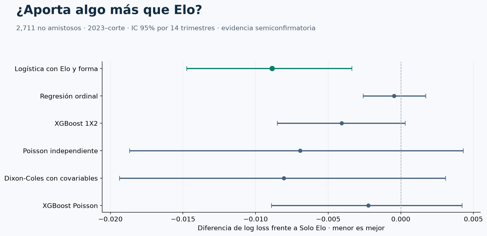

# Probabilidades de fútbol internacional

**Pregunta:** ¿mejoran el aprendizaje automático y los modelos de goles a un Elo simple al predecir partidos de selecciones?

**Resultado:** la logística con Elo y forma mejora frente a Solo Elo en la muestra amplia y los cuatro subperiodos; XGBoost no demuestra una mejora robusta. La ventaja no queda demostrada entre selecciones fuertes ni en los 72 partidos del Mundial.



Estudio retrospectivo. La evidencia 2023–corte es semiconfirmatoria por exposición previa al periodo. [Explorar los 72 partidos](reports/final_evaluation/football_report.html) · [Resultados](reports/final_evaluation/RESULTADOS.md) · [Explicación sencilla](docs/COMO_ENTENDER_EL_MODELO.md).

## Datos en una mirada

- **49,469 partidos** de 1872-11-30 a 2026-06-09 para actualizar Elo y forma; 337 entidades de selecciones, incluidas históricas.
- **21,781 partidos de 2000–2022** para ajustar los coeficientes congelados; **6.376** para selección con validación temporal.
- **3.624 partidos de 2023–corte** para evaluación, con **2.711 no amistosos** en la comparación principal.
- **72 pronósticos de grupos**, con probabilidades y resultados registrados al lado; **48 selecciones**.

Uso results, goalscorers, shootouts y former_names de martj42; Fjelstul para duración histórica; Openfootball y juegos de Transfermarkt para corroborar 2026 después del sellado. Ranking semestral y GeoNames quedan en ablaciones. No uso mercado actual ni extrapolo ranking FIFA a 2026. StatsBomb queda como validación opcional. Todas las fuentes son archivos locales suministrados, sin scraping.

El [diccionario de datos](docs/DATOS_Y_DICCIONARIO.md) explica el contenido, las cantidades, los marcadores a 90 minutos y cada variable. La logística recibe seis variables: diferencia efectiva de Elo, diferencias de goles a favor y recibidos, forma reciente, fuerza de rivales recientes y cobertura de las ventanas. Las variables se calculan únicamente con el pasado.

## Método y lectura de resultados

La referencia Solo Elo incluye sede fija. Comparo frecuencias, logística con forma, ordinal, XGBoost 1X2, Poisson, Dixon-Coles y XGBoost Poisson. No reajusto modelos desde 2022: actualizo solo el estado Elo y forma. **Logística estima 1X2; Poisson estima marcadores y su propio 1X2. No son el mismo producto.**

En no amistosos, log loss es **0.8478** para logística y **0.8567** para Elo. La diferencia tiene IC trimestral **[-0.0147; -0.0034]**. Remuestreo 2.000 veces bloques trimestrales completos; el bootstrap mensual es sensibilidad. Reporto Brier, RPS, acierto, fiabilidad por clase, NLL de marcador y resultados por población.

Entre equipos con ambos Elo >1700 (674 partidos) y entre las 48 selecciones del Mundial (406), los intervalos incluyen cero. La mejora de la muestra amplia no garantiza una ventaja en el tipo de encuentro más exigente.

Para inferencia exijo ≥200 partidos y ≥30 eventos por clase. Los 72 grupos y las eliminatorias son descriptivos. Las eliminatorias usan participantes conocidos retrospectivamente y no representan simulación ni pronósticos sellados antes del torneo.

## Reproducibilidad y documentación técnica

```powershell
python tools/verify_final_evaluation.py
```

La verificación comprueba modelos, protocolo y predicciones frente a sus hashes y commits; el CI informa pruebas y omisiones por datos locales. Los archivos grandes están fuera de Git y necesito las mismas fuentes para repetir el procesamiento. Uso dos hilos por defecto y no simulo cuadros de torneo.

- [Protocolo aprobado y umbral](reports/final_evaluation/PROTOCOLO_APROBADO.md).
- [Decisiones y límites](docs/DECISIONES_DE_DISEÑO.md), incluido el periodo semiconfirmatorio y la incidencia de secuencia registrada.
- [Datos, diccionario y cobertura](docs/DATOS_Y_DICCIONARIO.md).
- [Índice de auditorías](data_audit.json); cada protocolo y sello identifica el archivo exacto cubierto por SHA256.

models-selected conserva la selección anterior a 2023; phase4-protocol y phase4-protocol-approved son protocolos distintos; phase4-predictions-frozen identifica las predicciones anteriores a cargar resultados oficiales. Los modelos y métricas históricos de DataCamp están excluidos de comparaciones. El trabajo se construyó con el Mundial ya jugado y no se presenta como pronóstico publicado antes del torneo.

Cada fuente conserva sus condiciones originales. El código nuevo tiene licencia MIT.
