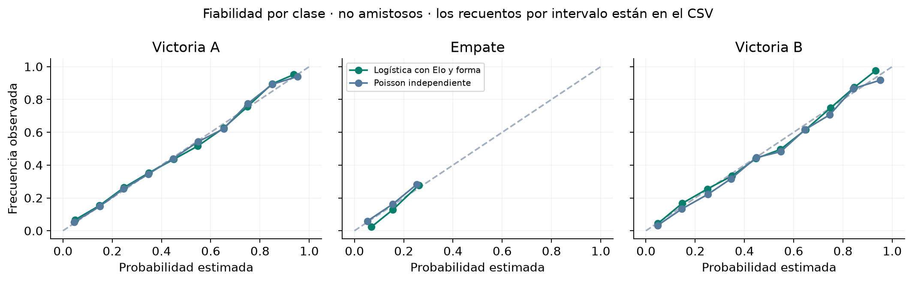

# Evaluación final del estudio retrospectivo

Mi pregunta es si aprendizaje automático y modelos de goles mejoran a Solo Elo al pronosticar partidos de selecciones. La logística con Elo y forma confirma su aporte en la evaluación semiconfirmatoria; XGBoost no demuestra una mejora robusta. En los 72 partidos de grupos no puedo declarar superioridad de la logística frente a Elo.

El Mundial ya estaba jugado al construir el estudio. El corte deportivo exclusivo es 2026-06-10. 2023–corte es **semiconfirmatorio**, porque la entrega histórica DataCamp ya puntuó 846 partidos de ese periodo; sus modelos y métricas no son comparadores.

## Resultado principal: 2023–corte

Evalué 3,624 partidos, incluidos 2,711 no amistosos. Frente a Elo, la logística reduce log loss en -0.008869, con IC trimestral [-0.014749; -0.003367], reduce Brier en -0.006302 y mejora en 4 de cuatro subperiodos. Cumple el criterio registrado antes de ejecutar. Esto confirma la selección dentro de evidencia con exposición previa; no la convierte en una prueba virgen.

| Modelo | N | Log loss | Brier | RPS | Acierto | Empates reales | Empates previstos | Diferencia vs Elo | IC diferencia | NLL marcador |
| --- | --- | --- | --- | --- | --- | --- | --- | --- | --- | --- |
| Frecuencias históricas | 2711 | 1.07088 | 0.64936 | 0.23733 | 0.45961 | 0.22538 | 0.23618 | 0.21417 | [0.18877; 0.23870] | No aplica |
| Solo Elo con sede fija | 2711 | 0.85671 | 0.50345 | 0.16726 | 0.61564 | 0.22538 | 0.22339 | 0.00000 | [0.00000; 0.00000] | No aplica |
| Logística con Elo y forma | 2711 | 0.84784 | 0.49715 | 0.16461 | 0.61527 | 0.22538 | 0.22333 | -0.00887 | [-0.01475; -0.00337] | No aplica |
| Regresión ordinal | 2711 | 0.85624 | 0.50330 | 0.16716 | 0.61564 | 0.22538 | 0.21964 | -0.00047 | [-0.00260; 0.00172] | No aplica |
| XGBoost 1X2 | 2711 | 0.85264 | 0.49966 | 0.16578 | 0.61638 | 0.22538 | 0.22134 | -0.00407 | [-0.00851; 0.00030] | No aplica |
| Poisson independiente | 2711 | 0.84979 | 0.49704 | 0.16465 | 0.61564 | 0.22538 | 0.20426 | -0.00693 | [-0.01867; 0.00430] | 2.88828 |
| Dixon-Coles con covariables | 2711 | 0.84866 | 0.49637 | 0.16452 | 0.61712 | 0.22538 | 0.21427 | -0.00806 | [-0.01939; 0.00308] | 2.88752 |
| XGBoost Poisson | 2711 | 0.85448 | 0.50044 | 0.16601 | 0.61638 | 0.22538 | 0.20889 | -0.00223 | [-0.00891; 0.00422] | 2.89577 |

Acierto y tasas de empate están expresados como proporciones. Brier suma las tres clases, sin dividir. RPS usa derrota/empate/victoria y divide la suma acumulada por dos. Las NLL de marcador están en semiconfirmatory_metrics.csv solo para modelos de goles.

## Representatividad, mínimos y sensibilidades

Fijé ambos Elo previos >1700 usando solo datos anteriores a 2023. Los cuatro bloques completos contienen 377, 416, 347, 260 partidos y todos cumplen los mínimos. 39 de las 48 selecciones superan 1700 al 2022-12-31; los 48 valores están en worldcup_48_elo_2022_12_31.csv. El cruce no amistoso de 2022 tiene N=184 y es descriptivo.

Declaro un estrato estimable solo con ≥200 partidos y ≥30 eventos de cada clase; cada subperiodo se evalúa por separado. Un grupo pequeño conserva sus puntos descriptivos y recuentos, pero no recibe una conclusión inferencial ni una regresión de calibración.

| Estrato | N | Victorias A | Empates | Victorias B | Estimable | Trimestres | Meses | Log loss | Diferencia vs Elo | IC diferencia |
| --- | --- | --- | --- | --- | --- | --- | --- | --- | --- | --- |
| Total | 3624 | 1702 | 846 | 1076 | True | 14 | 39 | 0.863037 | -0.007339 | [-0.01186; -0.00296] |
| No amistosos | 2711 | 1246 | 611 | 854 | True | 14 | 33 | 0.847844 | -0.008869 | [-0.01475; -0.00337] |
| Amistosos | 913 | 456 | 235 | 222 | True | 14 | 35 | 0.908150 | -0.002798 | [-0.00848; 0.00237] |
| Mundiales | 0 | 0 | 0 | 0 | False | 0 | 0 | No disponible | No disponible | No disponible |
| Ambos Elo >1700 | 674 | 291 | 199 | 184 | True | 14 | 31 | 1.007498 | -0.004619 | [-0.00983; 0.00091] |
| Ambos Elo >1700: no amistosos | 427 | 180 | 137 | 110 | True | 14 | 25 | 1.006729 | -0.006134 | [-0.01313; 0.00086] |
| 48 selecciones entre sí | 406 | 163 | 123 | 120 | True | 14 | 31 | 1.041584 | -0.010513 | [-0.02166; 0.00087] |
| Al menos una de las 48 selecciones | 1602 | 759 | 383 | 460 | True | 14 | 37 | 0.831136 | -0.007905 | [-0.01193; -0.00412] |
| Sin tandas/prórroga marcada | 3536 | 1700 | 760 | 1076 | True | 14 | 39 | 0.851632 | -0.007292 | [-0.01196; -0.00274] |
| Duración independiente verificada | 0 | 0 | 0 | 0 | False | 0 | 0 | No disponible | No disponible | No disponible |

La mejora global no equivale a superioridad demostrada en encuentros de mayor nivel: ambos Elo >1700 tiene N=674 y los partidos entre las 48 selecciones tienen N=406; sus intervalos de diferencia incluyen cero. El estrato de al menos una de las 48 frente a cualquier rival tiene N=1.602 e intervalo favorable, pero incluye rivales de distinta fuerza. No traslado ese resultado automáticamente a partidos entre selecciones fuertes.

El total tiene 14 trimestres observados y 39 meses; no amistosos tiene 14 trimestres y 33 meses. No sustituyo meses vacíos por clústeres artificiales. El protocolo preveía 14 trimestres y 42 meses posibles, incluido el último parcial.

Con 2.000 réplicas pareadas, el IC trimestral de la diferencia principal es [-0.014749; -0.003367], y el mensual es [-0.015118; -0.003117]. El criterio primario sigue siendo trimestral. Las sensibilidades no reentrenan ni cambian la política de forma del modelo congelado.

## Deriva sin reajuste

| Inicio | Fin exclusivo | N | Estimable | Trimestres | Meses | Log loss | Diferencia vs Elo |
| --- | --- | --- | --- | --- | --- | --- | --- |
| 2023-01-01 | 2024-01-01 | 813 | True | 4 | 9 | 0.824261 | -0.015120 |
| 2024-01-01 | 2025-01-01 | 990 | True | 4 | 10 | 0.893124 | -0.007423 |
| 2025-01-01 | 2026-01-01 | 781 | True | 4 | 10 | 0.802306 | -0.002101 |
| 2026-01-01 | 2026-06-10 | 127 | False | 2 | 4 | 0.925889 | -0.021738 |

Los coeficientes siguen ajustados únicamente hasta 2022. Actualizo Elo y forma con el pasado antes de cada partido, sin contaminación entre resultados del mismo día. Una mejora promedio no elimina la posibilidad de deriva o de que una población particular se comporte distinto.

## Calibración por clase

| Modelo | Clase | ECE complemento | Intercepto | Pendiente | Estado del ajuste |
| --- | --- | --- | --- | --- | --- |
| Logística con Elo y forma | Victoria A | 0.017860 | 0.014261 | 0.999420 | Solo diagnóstico |
| Logística con Elo y forma | Empate | 0.021182 | 0.486787 | 1.404701 | Solo diagnóstico |
| Logística con Elo y forma | Victoria B | 0.015377 | -0.034593 | 0.990406 | Solo diagnóstico |
| Poisson independiente | Victoria A | 0.013069 | 0.007118 | 0.989895 | Solo diagnóstico |
| Poisson independiente | Empate | 0.021122 | 0.243096 | 1.089598 | Solo diagnóstico |
| Poisson independiente | Victoria B | 0.024213 | -0.143430 | 1.001742 | Solo diagnóstico |

La recta de calibración es diagnóstica: idealmente intercepto 0 y pendiente 1. No la aplico a las predicciones. El ECE de diez intervalos fijos es complementario; las tablas de fiabilidad conservan el recuento de cada intervalo, incluidos los vacíos. Los estratos insuficientes quedan marcados, no reciben parámetros inventados.

## Dos productos y marcadores

Logística estima 1X2 directamente. Poisson estima tasas de goles y una matriz, de la cual sale su propio 1X2. Sus probabilidades difieren en promedio 2.4748 puntos porcentuales en 2023–corte y 2.1903 en los 72 pronósticos de grupos. No las reconcilio ni doy a entender que el 1X2 de la logística procede de la matriz Poisson.

Poisson es el producto descriptivo de marcadores elegido antes de 2023. Los modelos de goles no demostraron todo el criterio frente a Elo en selección; sus marcadores siguen disponibles sin afirmar que ese producto mejora el 1X2 principal. Las matrices y masas residuales se guardan con los pronósticos sellados.

## Mundial 2026: descripción de 72 partidos

| Modelo | N | Log loss | Brier | RPS | Acierto | Empates reales | Empates previstos | Diferencia vs Elo | IC diferencia | NLL marcador |
| --- | --- | --- | --- | --- | --- | --- | --- | --- | --- | --- |
| Frecuencias históricas | 72 | 1.09607 | 0.66463 | 0.23114 | 0.45833 | 0.27778 | 0.23618 | 0.19330 | [0.09128; 0.29651] | No aplica |
| Solo Elo con sede fija | 72 | 0.90277 | 0.54155 | 0.16752 | 0.62500 | 0.27778 | 0.23674 | 0.00000 | [0.00000; 0.00000] | No aplica |
| Logística con Elo y forma | 72 | 0.89730 | 0.53711 | 0.16518 | 0.62500 | 0.27778 | 0.24199 | -0.00547 | [-0.02611; 0.01416] | No aplica |
| Regresión ordinal | 72 | 0.91865 | 0.54622 | 0.16874 | 0.62500 | 0.27778 | 0.23563 | 0.01588 | [-0.00060; 0.03721] | No aplica |
| XGBoost 1X2 | 72 | 0.92123 | 0.54485 | 0.16755 | 0.62500 | 0.27778 | 0.23934 | 0.01846 | [-0.00058; 0.04131] | No aplica |
| Poisson independiente | 72 | 0.92065 | 0.54531 | 0.16772 | 0.61111 | 0.27778 | 0.22718 | 0.01788 | [-0.01913; 0.05939] | 3.00546 |
| Dixon-Coles con covariables | 72 | 0.91634 | 0.54452 | 0.16761 | 0.61111 | 0.27778 | 0.23858 | 0.01356 | [-0.02215; 0.05178] | 3.00128 |
| XGBoost Poisson | 72 | 0.91396 | 0.54271 | 0.16671 | 0.62500 | 0.27778 | 0.22153 | 0.01118 | [-0.00746; 0.03461] | 2.97620 |

La logística obtiene 0.897303 frente a 0.902773 de Elo. La diferencia -0.005470 tiene IC por fechas [-0.026110; 0.014157], que incluye cero. Los 72 partidos no cumplen el mínimo inferencial; no declaro un ganador. Reporto IC descriptivos por fecha UTC y sensibilidad por partido, con recuentos de clústeres. No supongo un error estándar fijo.

Los 72 marcadores de grupos coinciden con Openfootball; Transfermarkt corrobora 72, con 0 discrepancias de marcador. Hay 24 diferencias de día entre el registro local y el fixture UTC. Cruzar por pareja y fecha ±1 día resuelve la convención sin alterar pronósticos. Normalizo Turkiye y Democratic Republic of the Congo únicamente para corroborar esos registros actuales; no fusiono entidades históricas.

### Mayores errores de la logística

| Equipo A | Equipo B | Resultado 90 minutos | P victoria A | P empate | P victoria B | Log loss |
| --- | --- | --- | --- | --- | --- | --- |
| Spain | Cabo Verde | 0-0 | 0.87843 | 0.10360 | 0.01797 | 2.26724 |
| Ivory Coast | Ecuador | 1-0 | 0.12357 | 0.23258 | 0.64385 | 2.09093 |
| Ecuador | Curacao | 0-0 | 0.83640 | 0.13266 | 0.03095 | 2.01999 |
| South Africa | Korea Republic | 1-0 | 0.13966 | 0.24226 | 0.61808 | 1.96852 |
| England | Ghana | 0-0 | 0.80534 | 0.15230 | 0.04236 | 1.88189 |
| Canada | Bosnia-Herzegovina | 1-1 | 0.77302 | 0.17121 | 0.05577 | 1.76488 |
| Ghana | Panama | 1-0 | 0.18252 | 0.26245 | 0.55503 | 1.70088 |
| Uruguay | Cabo Verde | 2-2 | 0.75111 | 0.18318 | 0.06571 | 1.69726 |
| Qatar | Switzerland | 1-1 | 0.07685 | 0.19505 | 0.72809 | 1.63449 |
| Japan | Sweden | 1-1 | 0.67073 | 0.22159 | 0.10768 | 1.50691 |

Cada fila conserva la probabilidad asignada antes de ver el resultado y su pérdida. Un partido aislado no explica una mejora global; el listado completo está en worldcup_largest_errors.csv.

## Eliminatorias

Evalúo aparte 32 encuentros a 90 minutos, con catálogo independiente y pares explícitos de regulación en Openfootball para prórrogas. Se excluyen 0 por desacuerdo o falta de verificación. Los resultados están en worldcup_knockout_metrics.csv.

Esta evaluación es **condicional a participantes conocidos retrospectivamente**: uso los mismos coeficientes y el estado anterior al corte, sin actualizar con grupos del Mundial. Los emparejamientos se conocieron después de cargar resultados, por lo que no presento este bloque como predicciones de eliminatorias selladas previamente ni como simulación del cuadro.

## Trazabilidad y límites

El protocolo autoritativo es reports/final_evaluation/protocol_approved.json, con SHA256 `d017a20212e513b9e2f6f16aa6e7edf061a028b05a632ea90a381a7539372583`. Ese hash cubre los bytes de ese JSON; el sello y el documento humano tienen hashes propios. La etiqueta phase4-protocol anterior se conserva; phase4-protocol-approved registra las condiciones adicionales.

Las 72 predicciones se sellaron en 2026-10-12T20:10:42.383251+00:00 y el commit phase4-predictions-frozen precede a la carga oficial iniciada en 2026-10-12T20:13:34.153917+00:00. Los 43 artefactos congelados y cinco archivos protegidos de código permanecen intactos. No reajusto modelos ni comparo el pipeline DataCamp.

Registro una incidencia de secuencia: inicié la carga de resultados oficiales 10.312 segundos antes de terminar el remuestreo semiconfirmatorio. Los pronósticos ya estaban sellados y ambos procesos usaban entradas separadas; no hubo reajuste ni cambio de criterio. Conservo las fechas reales y no afirmo cumplimiento literal de ese orden de terminación.

Otros límites: duración supuesta en parte del historial, exposición previa al periodo semiconfirmatorio, selección de parámetros y variables en los mismos bloques anteriores a 2023, dependencia entre partidos que puede superar los bloques de remuestreo, comparaciones secundarias sin corrección múltiple, ausencia de pertenencia histórica suficiente para valor de mercado y ausencia de ranking FIFA vigente de 2026. La coincidencia entre archivos suministrados no sustituye una verificación externa de publicación oficial.

## Datos y reproducción

El estado al corte usa 49,469 partidos desde 1872-11-30 hasta 2026-06-09; los coeficientes congelados usan 21,781 partidos desde 2000 hasta 2022. El diccionario explica columnas originales, etiquetas y seis variables en [DATOS_Y_DICCIONARIO.md](../../docs/DATOS_Y_DICCIONARIO.md). Las tablas, intervalos, fiabilidad y sensibilidades se generan por código, sin descargas.
